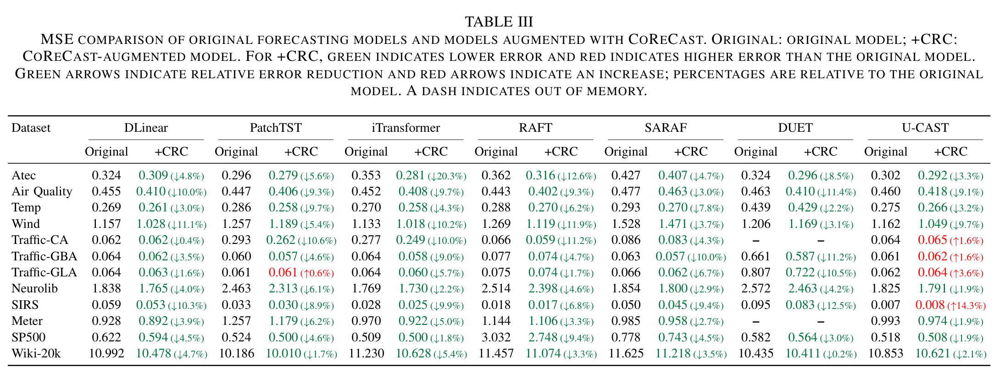
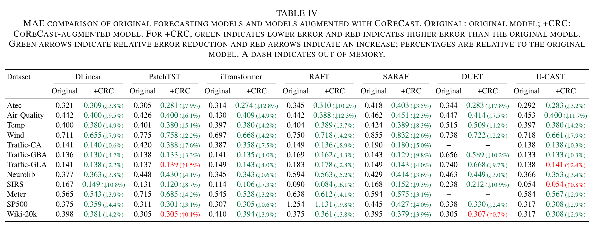
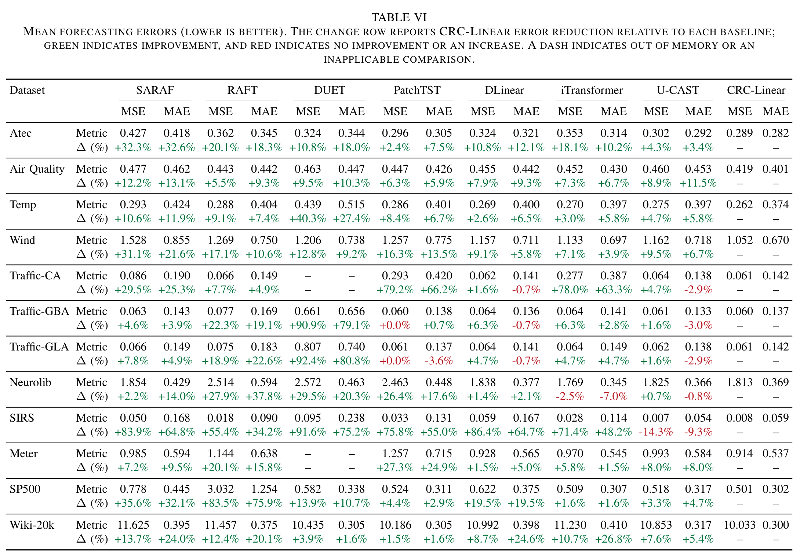
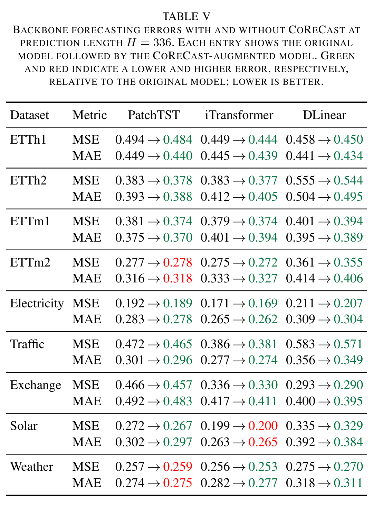
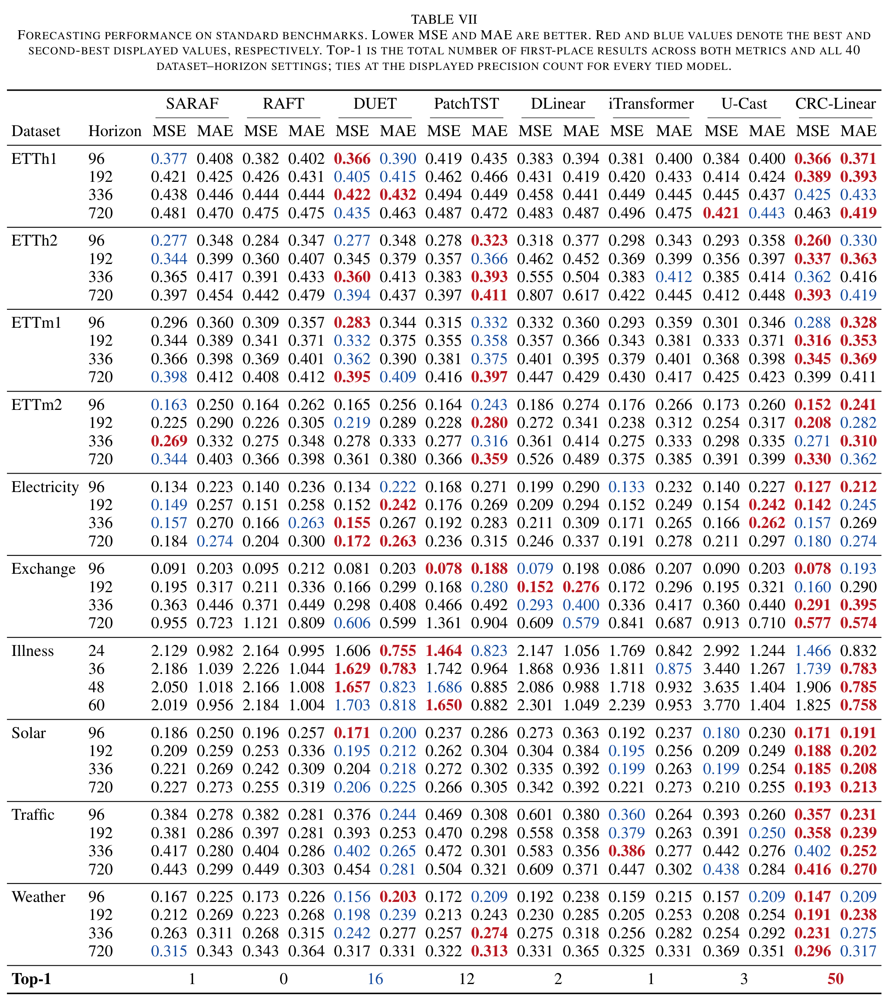

# CoReCast: Component-Level Retrieval for Time Series Forecasting

CoReCast 将趋势与季节分量分别检索，并将历史参考融入预测主干。CRC-Linear 是结合 CoReCast 的线性预测模型。


## 数据集


| 数据集 | 通道数 | 输入长度 L | 预测长度 H |
| --- | ---: | ---: | ---: |
| Atec | 1569 | 1008 | 336  |
| Air Quality | 1105 | 84 | 28  |
| Temp | 3774 | 504 | 168  |
| Wind | 3696 | 672 | 168  |
| Traffic-CA | 7491 | 672 | 168  |
| Traffic-GBA | 2229 | 672 | 168  |
| Traffic-GLA | 3376 | 672 | 168  |
| Neurolib | 2000 | 1344 | 336  |
| SIRS | 2994 | 28 | 7  |
| Meter | 2898 | 1344 | 336  |
| SP500 | 1475 | 28 | 7  |
| Wiki-20k | 20000 | 28 | 7  |
| Electricity（ECL） | 321 | 512 | 96/192/336/720  |
| ETTh1 | 7 | 512 | 96/192/336/720  |
| ETTh2 | 7 | 512 | 96/192/336/720  |
| ETTm1 | 7 | 512 | 96/192/336/720  |
| ETTm2 | 7 | 512 | 96/192/336/720  |
| Weather | 21 | 512 | 96/192/336/720  |
| Traffic | 862 | 512 | 96/192/336/720  |
| Exchange | 8 | 512 | 96/192/336/720  |
| Illness | 7 | 512 | 24/36/48/60  |
| Solar | 137 | 512 | 96/192/336/720  |

数据集来源：[U-CAST / Time-HD](https://huggingface.co/datasets/Time-HD-Anonymous/High_Dimensional_Time_Series) 和 [TFB](https://github.com/decisionintelligence/TFB)。

## 使用：Atec + DLinear

安装与 CUDA 环境匹配的 PyTorch，并安装依赖：

```bash
python -m pip install -r requirements.txt
```

将 Atec 数据保存为 `data/High_Dimensional_Time_Series/atec.csv`，然后在项目根目录运行：

```bash
python -u scripts/run_component_raft.py \
  --data Atec --model DLinear --variant retrieval \
  --seq-len 1008 --pred-len 336 --freq t \
  --groups 157 --topm 10 --max-candidates 32 --candidate-stride 84 \
  --batch-size 32 --epochs 100 --patience 5 --learning-rate 0.001 \
  --seed 2021 --device cuda --output results/atec_dlinear
```

结果保存在 `results/atec_dlinear`。

## 实验结果

以下表格摘自论文的 Table III、IV 和 VI。







<details>
<summary>论文中其他实验结果</summary>





</details>

[LICENSE](LICENSE)
